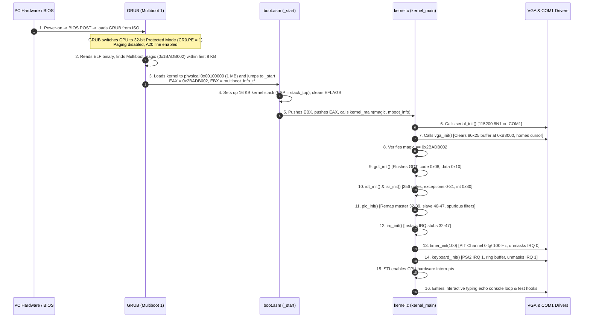

# System Architecture & Boot Flow

This document details the architectural layout, memory map, and end-to-end boot sequence of the 32-bit x86 Hobby Operating System.

---

## 1. End-to-End Boot Flow



---

## 2. Physical Memory Map (1 MB Identity-Mapped)

The kernel is loaded at 1 MB (`0x00100000`) to avoid conflicts with BIOS and legacy hardware reserved memory in low RAM:

```text
+-----------------------------------+ 0xFFFFFFFF (4 GB)
|                                   |
|      Unmapped Extended Memory     |
|                                   |
+-----------------------------------+
|      Available Extended RAM       |
+-----------------------------------+ _kernel_end (~0x00105000)
|      .bss (Stack 16 KB)           |
|      .data (Initialized globals)  |
|      .rodata (String literals)    |
|      .text (Executable code)      |
|      .multiboot (GRUB header)     |
+-----------------------------------+ 0x00100000 (1 MB) [_kernel_start]
|      BIOS ROM & Shadow RAM        |
+-----------------------------------+ 0x000C0000
|      VGA Text Buffer (0xB8000)    | -> 80x25 characters (4000 bytes)
+-----------------------------------+ 0x000A0000 (Video RAM)
|      Extended BIOS Data Area(EBDA)|
+-----------------------------------+ 0x0009FC00
|      Conventional RAM (Free)      |
+-----------------------------------+ 0x00007E00
|      MBR Boot Sector Area         |
+-----------------------------------+ 0x00007C00
|      BIOS Data Area (BDA)         |
+-----------------------------------+ 0x00000400
|      Real Mode IVT (256 vectors)  |
+-----------------------------------+ 0x00000000
```

---

## 3. Dual-Sink Kernel Logging Architecture

All kernel messages passed to `kprintf()` are mirrored across two hardware paths simultaneously:

```text
                      +-------------------+
                      |   kprintf(...)    |
                      +---------+---------+
                                |
                                v
                      +-------------------+
                      |      kputc(c)     |
                      +----+---------+----+
                           |         |
            +--------------+         +--------------+
            |                                       |
            v                                       v
  +--------------------+                  +--------------------+
  |    vga_putchar     |                  |   serial_putchar   |
  +---------+----------+                  +---------+----------+
            |                                       |
            v                                       v
  [0xB8000 Video RAM]                     [Port 0x3F8 UART]
  80x25 CRT Text Display                  COM1 Serial Output
  (Visible on Screen)                     (Redirected to C:\os\serial.log)
```

1. **VGA Path**: Writes 16-bit entries (ASCII character + color attribute byte) directly to physical memory at `0xB8000`. Handles line feeds (`\n`), carriage returns (`\r`), tab stops (`\t`), backspaces (`\b`), line scrolling (rows 1..24 shifted up), and updates the blinking hardware CRT cursor via I/O ports `0x3D4` / `0x3D5`.
2. **Serial Path**: Writes ASCII bytes directly to COM1 base port `0x3F8`. Polling Line Status Register (`0x3FD`) bit 5 guarantees bytes are not dropped. Bare `\n` is converted to CRLF (`\r\n`) so log files viewed in Windows editors format correctly.

---

## 4. Descriptor Tables & Interrupt Architecture (Milestone 2)

```text
+-------------------+      +-------------------+      +-------------------+
|     GDT (4 GB)    |      |    IDT (256)      |      |   PIC (Remapped)  |
| 0x00: Null        |      | 0-31: Exceptions  |      | Master: 32 - 39   |
| 0x08: Kernel Code |      | 32-47: IRQs       |      | Slave:  40 - 47   |
| 0x10: Kernel Data |      | 128: Software INT |      | Cascaded at IRQ 2 |
+-------------------+      +-------------------+      +-------------------+
```

### Stack Frame Layout Note (`registers_t`)
> **Important Architectural Note**:
> In Milestone 2, the kernel executes entirely in **Ring 0**. Because interrupts occur without a change in privilege level, the x86 CPU pushes only `EFLAGS`, `CS`, and `EIP` upon interrupt entry. The CPU does **NOT** push `useresp` or `ss` onto the stack.
>
> In **Milestone 5**, when Ring 3 user mode is introduced, the CPU will automatically push `useresp` and `ss` upon entering Ring 0 from Ring 3. The `registers_t` structure will be extended in Milestone 5 to include those fields.

