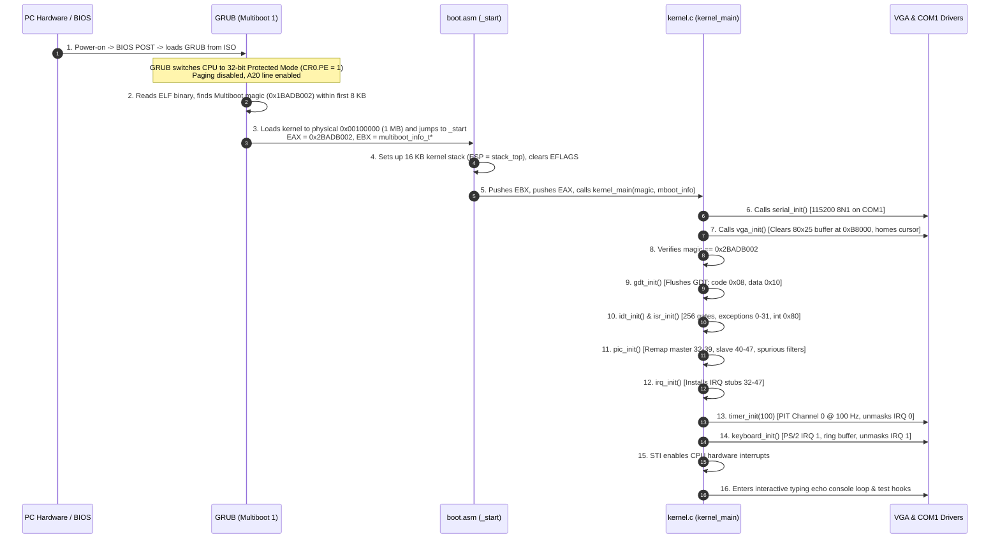

# System Architecture & Boot Flow

This document details the architectural layout, memory map, and end-to-end boot sequence of the 32-bit x86 Hobby Operating System.

---

## 1. End-to-End Boot Flow



---

## 2. Physical Memory Map (1 MB Identity-Mapped)

The kernel is loaded at 1 MB (`0x00100000`) to avoid conflicts with BIOS and legacy hardware reserved memory in low RAM:

```text
+-----------------------------------+ 0xFFFFFFFF (4 GB)
|                                   |
|      Unmapped Extended Memory     |
|                                   |
+-----------------------------------+
|      Available Extended RAM       |
+-----------------------------------+ _kernel_end (~0x00105000)
|      .bss (Stack 16 KB)           |
|      .data (Initialized globals)  |
|      .rodata (String literals)    |
|      .text (Executable code)      |
|      .multiboot (GRUB header)     |
+-----------------------------------+ 0x00100000 (1 MB) [_kernel_start]
|      BIOS ROM & Shadow RAM        |
+-----------------------------------+ 0x000C0000
|      VGA Text Buffer (0xB8000)    | -> 80x25 characters (4000 bytes)
+-----------------------------------+ 0x000A0000 (Video RAM)
|      Extended BIOS Data Area(EBDA)|
+-----------------------------------+ 0x0009FC00
|      Conventional RAM (Free)      |
+-----------------------------------+ 0x00007E00
|      MBR Boot Sector Area         |
+-----------------------------------+ 0x00007C00
|      BIOS Data Area (BDA)         |
+-----------------------------------+ 0x00000400
|      Real Mode IVT (256 vectors)  |
+-----------------------------------+ 0x00000000
```

---

## 3. Dual-Sink Kernel Logging Architecture

All kernel messages passed to `kprintf()` are mirrored across two hardware paths simultaneously:

```text
                      +-------------------+
                      |   kprintf(...)    |
                      +---------+---------+
                                |
                                v
                      +-------------------+
                      |      kputc(c)     |
                      +----+---------+----+
                           |         |
            +--------------+         +--------------+
            |                                       |
            v                                       v
  +--------------------+                  +--------------------+
  |    vga_putchar     |                  |   serial_putchar   |
  +---------+----------+                  +---------+----------+
            |                                       |
            v                                       v
  [0xB8000 Video RAM]                     [Port 0x3F8 UART]
  80x25 CRT Text Display                  COM1 Serial Output
  (Visible on Screen)                     (Redirected to C:\os\serial.log)
```

1. **VGA Path**: Writes 16-bit entries (ASCII character + color attribute byte) directly to physical memory at `0xB8000`. Handles line feeds (`\n`), carriage returns (`\r`), tab stops (`\t`), backspaces (`\b`), line scrolling (rows 1..24 shifted up), and updates the blinking hardware CRT cursor via I/O ports `0x3D4` / `0x3D5`.
2. **Serial Path**: Writes ASCII bytes directly to COM1 base port `0x3F8`. Polling Line Status Register (`0x3FD`) bit 5 guarantees bytes are not dropped. Bare `\n` is converted to CRLF (`\r\n`) so log files viewed in Windows editors format correctly.

---

## 4. Descriptor Tables & Interrupt Architecture (Milestone 2)

```text
+-------------------+      +-------------------+      +-------------------+
|     GDT (4 GB)    |      |    IDT (256)      |      |   PIC (Remapped)  |
| 0x00: Null        |      | 0-31: Exceptions  |      | Master: 32 - 39   |
| 0x08: Kernel Code |      | 32-47: IRQs       |      | Slave:  40 - 47   |
| 0x10: Kernel Data |      | 128: Software INT |      | Cascaded at IRQ 2 |
+-------------------+      +-------------------+      +-------------------+
```

### Stack Frame Layout Note (`registers_t`)
> **Important Architectural Note**:
> In Milestone 2, the kernel executes entirely in **Ring 0**. Because interrupts occur without a change in privilege level, the x86 CPU pushes only `EFLAGS`, `CS`, and `EIP` upon interrupt entry. The CPU does **NOT** push `useresp` or `ss` onto the stack.
>
> In **Milestone 5**, when Ring 3 user mode is introduced, the CPU will automatically push `useresp` and `ss` upon entering Ring 0 from Ring 3. The `registers_t` structure will be extended in Milestone 5 to include those fields.

---

## 5. Memory Management Architecture (Milestone 3)

```text
Physical Memory (PMM)                Virtual Memory (Paging)
+----------------------------+       +----------------------------+ 0xFFFFFFFF
| Available Frames (Type 1)  |       | Unmapped Address Space     |
| (Managed by 128KB Bitmap)  |       +----------------------------+ 0xD4000000 (64MB)
+----------------------------+       | Virtual Kernel Heap        |
| Reserved Bootloader & Mmap |  ==>  | (Grows upwards on demand)  |
+----------------------------+       +----------------------------+ 0xD0000000 (Heap Start)
| Kernel Image & .bss Bitmap |       | Unmapped Address Space     |
+----------------------------+       +----------------------------+ 0x10000000 (256MB Cap)
| BIOS ROM & VGA Buffer      |       | Identity-Mapped RAM        |
+----------------------------+       | (Virtual == Physical)      |
| Frame 0 (0x0 - 0xFFF)      |       +----------------------------+ 0x00001000 (4KB)
+----------------------------+ 0x0   | UNMAPPED Page 0 (NULL Trap)|
                                     +----------------------------+ 0x00000000
```

* **PMM (Bitmap)**: Statically tracks 1,048,576 4 KB frames using 131,072 bytes (128 KB) in `.bss`.
* **Two-Level Paging**:
  * Page Directory points to 32–64 Page Tables mapping physical memory.
  * Identity maps all detected physical RAM (capped at 256 MB) so page-table frames allocated from anywhere in RAM can be written through their physical addresses.
  * Page 0 is left unmapped so any zero-pointer dereference immediately causes a hardware Page Fault (`#PF`).
* **Kernel Heap**:
  * Base virtual address `0xD0000000`, expands page-by-page up to 64 MB.
  * 24-byte headers (`magic`, `size`, `is_free`, `padding`, `next`, `prev`), guaranteed 8-byte payload alignment, bi-directional coalescing on `kfree()`.

---

## 6. GUI Foundation Architecture (Milestone 4)

```text
+-----------------------------------------------------------------------------------+
|                            Display & Input Subsystem                              |
+-----------------------------------------------------------------------------------+
|  Hardware Inputs:                                                                 |
|    - PS/2 Keyboard: IRQ 1 (Port 0x60/0x64), Scancode Set 1, Circular Buffer       |
|    - PS/2 Mouse:    IRQ 12 (Aux Port 0x64/0x60), 3-Byte Packet Assembly,          |
|                     Event Coalescing, Cascade IRQ 2 Unmasked                      |
+-----------------------------------------------------------------------------------+
|  Display Layer (1024x768x32 Linear Framebuffer):                                  |
|    - Multiboot 1 Mode Request: Flags bit 2, Mode Type 0, 1024x768x32              |
|    - Physical MMIO Base: 0xE0000000 (VirtualBox VRAM), 768 Pages (3 MB)          |
|    - Page Mapping: Mapped with PAGE_PCD (Page Cache Disable) to prevent tearing  |
|    - 8x16 Bitmap Font: 95 public-domain ASCII glyphs (32-126)                     |
|    - Text Console: 128x48 character grid stored in RAM (console_cells[48][128])  |
|      Scrolling reads strictly from system RAM with zero VRAM reads                |
+-----------------------------------------------------------------------------------+
|  2D Graphics Engine & Software Cursor:                                            |
|    - Off-Screen Back Buffer: 3 MB allocated from Heap at 0xD0000000 via kmalloc    |
|    - Primitives: Bresenham lines, thick brush lines, filled/outline rectangles    |
|    - Dirty Rect Flusher: gfx_flush_rect copies only modified bounding boxes        |
|    - Software Cursor: 12x19 arrow sprite rendered directly to VRAM                |
|      Save-under RAM buffer restores background without touching back buffer       |
|      Flushes overlapping cursor automatically hide and restore it                 |
+-----------------------------------------------------------------------------------+
```

### Component Interaction:
1. **ISR Safety**: Neither the timer (IRQ 0) nor mouse (IRQ 12) interrupt handlers perform drawing operations or call `kprintf()`. The timer sets `timer_clock_dirty = true` for the main loop, while the mouse handler enqueues movement deltas into a volatile ring buffer.
2. **Back Buffer Isolation**: The back buffer in system RAM contains only application and canvas pixels, never the cursor.
3. **Save-Under Cursor**: When the cursor moves, the old 12x19 area is restored to VRAM from `save_under`, and the new 12x19 area is saved from the clean back buffer and drawn directly in VRAM. Mouse moves never trigger full-screen flushes.

---

## 7. Window Manager and Widgets Architecture (Milestone 5)

```text
+-----------------------------------------------------------------------------------+
|                        Window Manager & Compositor Layer                          |
+-----------------------------------------------------------------------------------+
|  Window Data Structure (window_t):                                                |
|    - Coordinates: (x, y), Dimensions: (width, height)                             |
|    - Client Area: (client_x, client_y), Size: (client_w, client_h)                |
|    - Canvas Buffer: Isolated RAM allocation (client_w * client_h * 4 bytes)       |
|    - Flags: VISIBLE, FOCUSED, MOVABLE, MINIMIZED                                  |
|    - Widgets List: Doubly linked list of child UI controls                        |
+-----------------------------------------------------------------------------------+
|  Z-Order Compositing Pipeline (Painter's Algorithm):                              |
|    1. Redraw Desktop Background (Solid 0x003A6EA5 or pattern)                    |
|    2. Render Taskbar at Screen Bottom (y = 736..767, Start button, tabs, clock)  |
|    3. Traverse Z-Order List from Bottom to Top (wm_bottom_window -> prev):        |
|       - Draw 2px 3D outer border                                                  |
|       - Draw Title Bar (Active Blue 0x001F487E or Inactive Gray 0x007A8A9E)       |
|       - Draw Window Title Text & Close Button [X]                                 |
|       - Blit window client_buffer into Off-Screen Back Buffer with clipping       |
|    4. Flush Dirty Rectangle to VRAM (gfx_flush_rect) with cursor protection       |
+-----------------------------------------------------------------------------------+
|  Input & Event Dispatch Flow:                                                     |
|    - Mouse Click -> Top-to-Bottom Window Hit Test (wm_top_window -> next)         |
|      * Title Bar: Initiates window drag; clamps (x, y) to desktop bounds          |
|      * Close Button [X]: Destroys window and child widgets, frees client_buffer   |
|      * Client Area: Dispatches mouse click to child widget hierarchy              |
|    - Keyboard Event -> Dispatched to currently focused text box widget            |
+-----------------------------------------------------------------------------------+
|  Widget Framework (widget_t):                                                     |
|    - Button: 3D beveled relief (light top-left, dark bottom-right; inverted click)|
|    - Label: Single-line string rendering with customizable text colors            |
|    - Textbox: Sunken border, caret cursor, keyboard buffer append, backspace      |
+-----------------------------------------------------------------------------------+
```

### Key Architectural Invariants:
1. **Client Memory Isolation**: Applications write only to their window's `client_buffer`. An application never directly modifies the screen back buffer or VRAM. This guarantees that window dragging and overlapping window composition never corrupt application contents.
2. **Opposite Traversal Invariant**: Compositing *always* traverses **Bottom-to-Top** (so foreground windows paint over background windows), while hit-testing *always* traverses **Top-to-Bottom** (so the topmost visible window intercepts mouse clicks).
3. **Desktop Boundaries**: Window dragging enforces strict clamping: a window's title bar cannot be dragged above the top of the screen (`y >= 0`) or below the taskbar (`y <= 736 - title_bar_height`), preventing orphaned or unreachable windows.


