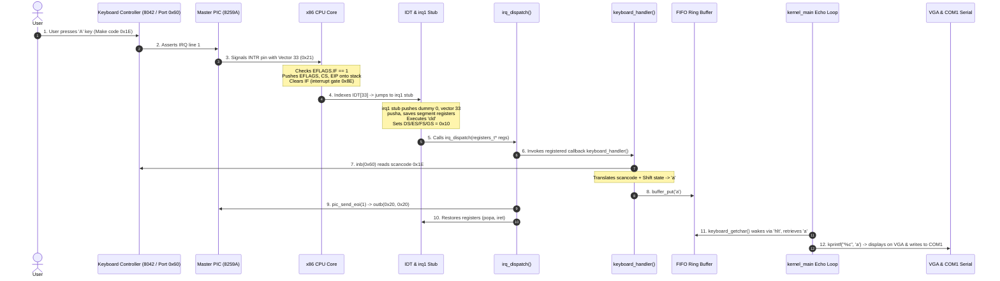

# Milestone 2: Interrupts & Drivers

## 1. Goal & Deliverables
The objective of Milestone 2 is to enable the operating system to respond to asynchronous hardware events and CPU faults:
1. **Global Descriptor Table (GDT)**: Establish a flat memory model (Null, Kernel Code, Kernel Data) and reload all segment registers (far jump for `CS`).
2. **Interrupt Descriptor Table (IDT)**: Build and load a 256-entry table mapping interrupts and exceptions.
3. **CPU Exceptions & ISRs**: Low-level assembly stubs for vectors 0–31 that push uniform stack frames and invoke a central panic dump handler.
4. **8259A PIC Remapping**: Move master IRQs to vectors 32–39 and slave IRQs to vectors 40–47, with spurious interrupt mitigation (no EOI on spurious IRQ 7; master-only EOI on spurious IRQ 15).
5. **Hardware IRQ Dispatcher**: Interrupt registration table and central dispatcher that automates End-of-Interrupt (EOI) signaling.
6. **Programmable Interval Timer (PIT)**: Drive Channel 0 at 100 Hz, track uptime, update an in-place top-right screen clock via `vga_put_at`, and sleep via `hlt`.
7. **PS/2 Keyboard Driver**: IRQ 1 handler translating Scancode Set 1 to ASCII (Shift, Caps Lock, Backspace, Enter, Tab, Space, and `0xE0` extended key filtering), with a circular FIFO buffer.
8. **Interactive Echo Console & Test Hooks**: Live typing echo, serial logging of uptime every 5 seconds, F1 divide-by-zero exception test hook, and F2 software interrupt (`int 0x80`) test hook.

---

## 2. Hardware Keystroke Pipeline: From Key Press to Screen



---

## 3. Core Architectural Concepts Explained Simply

### 1. What is the Global Descriptor Table (GDT)?
Even though our OS uses a **flat memory model** where all addresses span the full 4 GB physical address space (base = `0`, limit = `0xFFFFF` with 4 KB granularity), the x86 protected mode processor requires a GDT. The GDT tells the CPU what privilege level is required (Ring 0 vs Ring 3) and whether memory contains executable instructions (`CS = 0x08`) or readable/writable data (`DS/ES/FS/GS/SS = 0x10`).

### 2. What is the Interrupt Descriptor Table (IDT)?
The IDT is a table of 256 8-byte descriptors that replaces the 16-bit real-mode Interrupt Vector Table (IVT). When an event occurs (such as dividing by zero or pressing a key), the CPU looks up the vector number in the IDT, retrieves the address of the corresponding assembly stub, and jumps to it.

### 3. What is the difference between an Exception and an IRQ?
* **Exception (Vectors 0–31)**: Synchronous event generated directly inside the CPU core as a result of an instruction execution error (e.g., dividing by zero, executing an invalid opcode, or accessing unmapped memory).
* **IRQ / Interrupt (Vectors 32–47)**: Asynchronous event generated outside the CPU by independent hardware peripherals (e.g., timer chip ticking, keyboard key pressed). They can occur at any time between instructions.

### 4. What is the 8259 PIC and why must it be remapped?
The IBM PC motherboard has two 8259 Programmable Interrupt Controllers (Master and Slave). By default, the BIOS programs the Master PIC to trigger vectors 8–15. In protected mode, Intel reserved vectors 0–31 for CPU exceptions (e.g. vector 8 is Double Fault, vector 13 is General Protection Fault). If the PIC is not remapped, a timer tick (IRQ 0) would trigger vector 8, tricking the kernel into treating a clock tick as a fatal Double Fault exception. We remap the PIC to vectors 32–47 (above Intel's reserved 0–31 range).

### 5. What is the Programmable Interval Timer (PIT 8254)?
The PIT is an onboard hardware counter driven by an internal 1.193182 MHz crystal oscillator. By loading a 16-bit divisor into Channel 0 (`1193182 / 100 = 11931`), the PIT pulses IRQ 0 exactly 100 times every second. This gives the kernel a reliable real-time heartbeat.

---

## 4. Interrupt Vector Table Map

| Vector Range | Source | Description | Handled By |
| :--- | :--- | :--- | :--- |
| `0` | CPU Exception | `#DE` Divide by Zero | Panic Screen (**Tested via F1 key**) |
| `1` | CPU Exception | `#DB` Debug | Panic Screen |
| `2` | CPU Exception | `NMI` Non-Maskable Interrupt | Panic Screen |
| `3` | CPU Exception | `#BP` Breakpoint | Panic Screen |
| `4` | CPU Exception | `#OF` Overflow | Panic Screen |
| `5` | CPU Exception | `#BR` Bound Range Exceeded | Panic Screen |
| `6` | CPU Exception | `#UD` Invalid Opcode | Panic Screen |
| `7` | CPU Exception | `#NM` Device Not Available | Panic Screen |
| `8` | CPU Exception | `#DF` Double Fault (error code) | Panic Screen |
| `13` | CPU Exception | `#GP` General Protection Fault (error code) | Panic Screen |
| `14` | CPU Exception | `#PF` Page Fault (error code) | Panic Screen |
| `15 - 31` | CPU Exceptions | Reserved Intel Faults / Traps | Panic Screen |
| `32` | Hardware IRQ 0 | PIT Timer (100 Hz) | `timer_handler()` |
| `33` | Hardware IRQ 1 | PS/2 Keyboard | `keyboard_handler()` |
| `34` | Hardware IRQ 2 | PIC Cascade Line | Slave PIC forwarding |
| `36` | Hardware IRQ 4 | COM1 Serial Port | Reserved for serial RX |
| `39` | Hardware IRQ 7 | Master Spurious Interrupt | `pic_is_spurious_irq7()` (no EOI) |
| `40` | Hardware IRQ 8 | Real-Time Clock (RTC) | Generic IRQ |
| `47` | Hardware IRQ 15| Slave Spurious Interrupt | `pic_is_spurious_irq15()` (master EOI only) |
| `128` (`0x80`)| Software Trap | Software Interrupt Gate | Test Hook (**Tested via F2 key**) |

---

## 5. ISR Stack Frame Layout (`registers_t`)

> **Architectural Note**:
> In Milestone 2, the kernel runs entirely in Ring 0. When an interrupt occurs, the CPU does not change privilege levels, so `useresp` and `ss` are NOT pushed onto the stack by hardware. In Milestone 5, when Ring 3 user mode is implemented, the CPU will automatically push `useresp` and `ss` upon entering Ring 0 from Ring 3, and `registers_t` will be extended accordingly.

```text
High Memory
  │  [EFLAGS]         <-- Pushed automatically by CPU hardware
  │  [CS]             <-- Pushed automatically by CPU hardware
  │  [EIP]            <-- Pushed automatically by CPU hardware
  │  [Error Code]     <-- Pushed by CPU or dummy 0 pushed by stub
  │  [Interrupt Num]  <-- Pushed by ISR/IRQ assembly stub
  │  [EAX]            <-- Pushed by pusha
  │  [ECX]            <-- Pushed by pusha
  │  [EDX]            <-- Pushed by pusha
  │  [EBX]            <-- Pushed by pusha
  │  [ESP (ignored)]  <-- Pushed by pusha
  │  [EBP]            <-- Pushed by pusha
  │  [ESI]            <-- Pushed by pusha
  │  [EDI]            <-- Pushed by pusha
  │  [DS]             <-- Pushed by stub
  │  [ES]             <-- Pushed by stub
  │  [FS]             <-- Pushed by stub
  ▼  [GS]             <-- Pushed by stub (ESP points here upon calling C)
Low Memory
```

---

## 6. Files Created / Modified and Their Roles

| File | Role |
| :--- | :--- |
| [`include/arch/gdt.h`](file:///c:/Users/pruthvi/Desktop/Hobbies/O.S/include/arch/gdt.h) / [`src/arch/gdt.c`](file:///c:/Users/pruthvi/Desktop/Hobbies/O.S/src/arch/gdt.c) | Flat GDT setup (Null, Kernel Code `0x08`, Kernel Data `0x10`). |
| [`src/arch/gdt_flush.asm`](file:///c:/Users/pruthvi/Desktop/Hobbies/O.S/src/arch/gdt_flush.asm) | `lgdt` instruction and far jump reload for `CS`, `DS`, `ES`, `FS`, `GS`, `SS`. |
| [`include/arch/idt.h`](file:///c:/Users/pruthvi/Desktop/Hobbies/O.S/include/arch/idt.h) / [`src/arch/idt.c`](file:///c:/Users/pruthvi/Desktop/Hobbies/O.S/src/arch/idt.c) | 256-entry IDT descriptor table and `lidt` instruction. |
| [`include/arch/isr.h`](file:///c:/Users/pruthvi/Desktop/Hobbies/O.S/include/arch/isr.h) / [`src/arch/isr.c`](file:///c:/Users/pruthvi/Desktop/Hobbies/O.S/src/arch/isr.c) | Exception dispatcher, register dump panic screen, and vector 128 software interrupt hook. |
| [`src/arch/isr_stubs.asm`](file:///c:/Users/pruthvi/Desktop/Hobbies/O.S/src/arch/isr_stubs.asm) | Assembly stubs 0–31 & 128 (dummy error codes, register saving, `cld`, selector reload). |
| [`include/arch/pic.h`](file:///c:/Users/pruthvi/Desktop/Hobbies/O.S/include/arch/pic.h) / [`src/arch/pic.c`](file:///c:/Users/pruthvi/Desktop/Hobbies/O.S/src/arch/pic.c) | 8259A PIC initialization, ICW1-ICW4 remap, masking, EOI, and spurious IRQ detection. |
| [`include/arch/irq.h`](file:///c:/Users/pruthvi/Desktop/Hobbies/O.S/include/arch/irq.h) / [`src/arch/irq.c`](file:///c:/Users/pruthvi/Desktop/Hobbies/O.S/src/arch/irq.c) | IRQ registration table, IRQ 0–15 dispatching, automated EOI signaling. |
| [`src/arch/irq_stubs.asm`](file:///c:/Users/pruthvi/Desktop/Hobbies/O.S/src/arch/irq_stubs.asm) | Assembly stubs for IRQs 0–15 (`pusha`, `cld`, segment switch, invoke `irq_dispatch`). |
| [`include/drivers/timer.h`](file:///c:/Users/pruthvi/Desktop/Hobbies/O.S/include/drivers/timer.h) / [`src/drivers/timer.c`](file:///c:/Users/pruthvi/Desktop/Hobbies/O.S/src/drivers/timer.c) | PIT Channel 0 at 100 Hz, uptime clock, in-place screen updates via `vga_put_at`, `timer_sleep_ms`. |
| [`include/drivers/keyboard.h`](file:///c:/Users/pruthvi/Desktop/Hobbies/O.S/include/drivers/keyboard.h) / [`src/drivers/keyboard.c`](file:///c:/Users/pruthvi/Desktop/Hobbies/O.S/src/drivers/keyboard.c) | PS/2 driver, Scancode Set 1 decoding, Shift/Caps modifiers, `0xE0` filtering, circular FIFO buffer. |
| [`src/drivers/vga.c`](file:///c:/Users/pruthvi/Desktop/Hobbies/O.S/src/drivers/vga.c) | Added `vga_put_at(x, y, str, color)` for non-intrusive clock rendering. |
| [`src/kernel/kernel.c`](file:///c:/Users/pruthvi/Desktop/Hobbies/O.S/src/kernel/kernel.c) | Init pipeline, echo loop, 5-second uptime serial logger, F1 divide-by-zero & F2 `int 0x80` hooks. |

---

## 7. Eight Likely Viva Questions & Answers

### Q1: Why must the 8259 PIC be remapped in x86 protected mode?
**Answer**:
By default in IBM PC compatibles, the BIOS maps Master PIC IRQs 0–7 to interrupt vectors 8–15. In protected mode, Intel specifically reserved vectors 0–31 for CPU exceptions (e.g. vector 8 is Double Fault, vector 13 is General Protection Fault). Remapping the PIC to vectors 32–47 prevents hardware IRQs from colliding with and masquerading as CPU hardware faults.

### Q2: What happens if an IRQ handler forgets to send an End of Interrupt (EOI) to the PIC?
**Answer**:
The PIC sets a bit in its In-Service Register (ISR) when an interrupt request is dispatched to the CPU and will not acknowledge or deliver any subsequent interrupts of equal or lower priority on that PIC chip. Forgetting EOI freezes that interrupt line forever (e.g. the timer or keyboard stops functioning after its very first event).

### Q3: Why is an error code pushed onto the stack for only some exceptions?
**Answer**:
Exceptions related to memory management, descriptor tables, or privilege violations (e.g., `#DF` Double Fault [8], `#TS` Invalid TSS [10], `#NP` Segment Not Present [11], `#SS` Stack Fault [12], `#GP` General Protection [13], `#PF` Page Fault [14], and `#AC` Alignment Check [17]) provide specific diagnostic bitmasks (such as the selector index or page-fault error bits). Other exceptions (like `#DE` Divide by Zero) do not have diagnostic codes, so the CPU hardware pushes nothing. Our assembly stubs push a dummy `0` for non-error exceptions to keep the C `registers_t` stack frame identical.

### Q4: What does the IDT gate attribute byte `0x8E` signify?
**Answer**:
`0x8E` in binary is `10001110b`:
- **Bit 7 (`1`)**: Present bit (descriptor is valid in memory).
- **Bits 6–5 (`00`)**: Descriptor Privilege Level (DPL = Ring 0; only kernel can invoke).
- **Bit 4 (`0`)**: Storage Segment (0 for interrupt/trap gates).
- **Bits 3–0 (`1110` / `0x0E`)**: Gate type (32-bit Interrupt Gate).
Crucially, an **Interrupt Gate** (`0x8E`) causes the CPU to automatically clear the `IF` flag in `EFLAGS` upon entry, temporarily disabling nested interrupts to prevent race conditions during stack setup. A **Trap Gate** (`0x8F`) leaves `IF` unchanged.

### Q5: Why is an explicit far jump needed after loading the GDT with `lgdt`?
**Answer**:
The `lgdt` instruction only loads the linear base address and limit of the descriptor table into the CPU's internal `GDTR` register; it does not update the selector or descriptor caches of the segment registers. While data segment registers (`DS`, `ES`, `SS`) can be updated with `mov ds, ax`, the Code Segment register (`CS`) cannot be written directly. Executing a far jump (`jmp 0x08:.reload_cs`) flushes the CPU instruction prefetch pipeline and forces the hardware to reload `CS` with selector `0x08`.

### Q6: Why must we execute `cld` before calling C functions from an interrupt stub?
**Answer**:
The System V x86 ABI specifies that the Direction Flag (`DF` in `EFLAGS`) must be cleared (`0`) upon function entry. If the interrupted code was executing a string instruction with `DF = 1` (decrementing addresses, e.g. `std`), any C library code inside the interrupt handler utilizing string operations (like `memcpy` or `strlen`) would operate backward in memory, corrupting data structures. Executing `cld` resets the direction flag to forward.

### Q7: What is a spurious interrupt and how does the kernel handle it?
**Answer**:
A spurious interrupt occurs when an input line on the PIC experiences an electrical noise glitch or when an interrupt request is deasserted before the CPU acknowledges it. The PIC defaults to reporting IRQ 7 (for Master) or IRQ 15 (for Slave).
- **Master Spurious IRQ 7**: We query the PIC In-Service Register (ISR). If bit 7 is `0`, it is spurious; we return immediately **without sending an EOI** (sending EOI would clear a real in-service interrupt).
- **Slave Spurious IRQ 15**: If bit 7 of Slave ISR is `0`, we do NOT send EOI to the Slave, but we **MUST send EOI to the Master**, because the Master already latched cascade IRQ 2.

### Q8: How does `timer_sleep_ms` work without wasting CPU cycles?
**Answer**:
Instead of a CPU-intensive busy-wait loop (`while(ticks < target);`), `timer_sleep_ms` executes the x86 `hlt` instruction inside its loop: `while (timer_ticks < target) { __asm__ volatile ("hlt"); }`. The `hlt` instruction halts CPU execution and places the core into a low-power state until the next hardware interrupt (the 100 Hz timer tick) awakens it.
