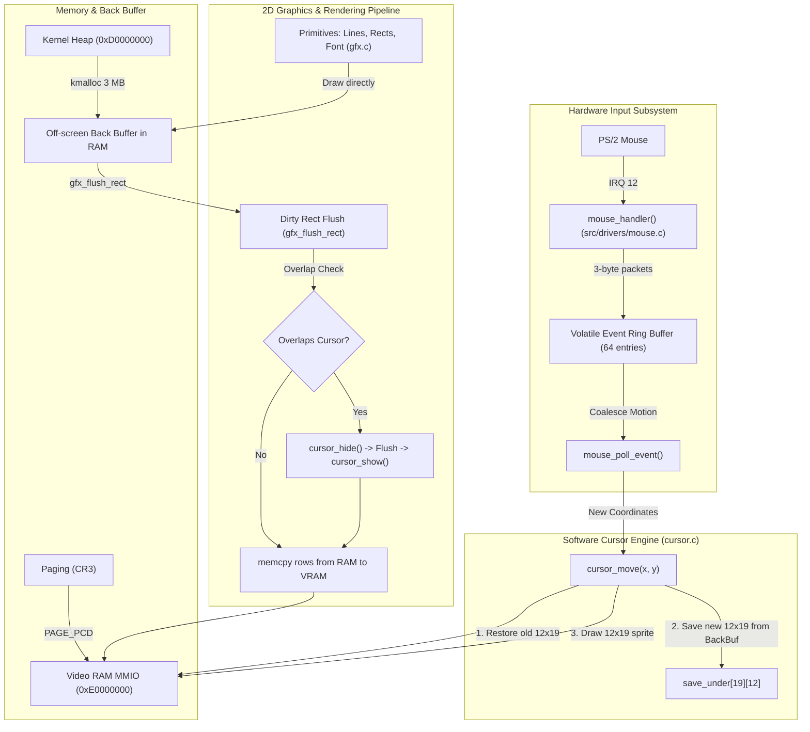

# Milestone 4: GUI Foundation (Graphics Mode, Mouse Driver & Software Cursor)

## 1. Goal and What Was Built

The primary objective of Milestone 4 is establishing the complete graphical display and mouse interaction substrate for the desktop operating system. Rather than relying on a legacy 80x25 command-line terminal, the OS transitions into a high-resolution 32-bit linear framebuffer with hardware-driven mouse input, off-screen double buffering, software cursor rendering, and interactive painting.

### Core Deliverables
1. **Multiboot 1 Linear Framebuffer**:
   - Extended `boot.asm` Multiboot header with video mode request bit 2, 5 address padding dwords, and requested mode `1024x768x32` linear RGB.
   - Updated `grub.cfg` with `insmod all_video`, `set gfxmode=1024x768x32`, and `set gfxpayload=keep`.
   - Buffered Multiboot information structure before memory management and mapped VRAM MMIO (physical `0xE0000000`, 3 MB / 768 pages) into two-level paging with `PAGE_PCD` (Cache Disable) to prevent stale cache writes on the display.
2. **8x16 Bitmap Font & Framebuffer Terminal Console**:
   - Embedded 95 public-domain ASCII bitmap glyphs (ASCII 32–126).
   - Implemented a 128-column by 48-row text terminal emulator (`fb_console.c`) stored entirely in system RAM (`console_cells[48][128]`, 12 KB in `.bss`).
   - Terminal scrolling shifts the in-RAM array via `memmove` and redraws without reading from slow video RAM over the PCI bus.
   - Seamlessly routed `vga_*` and `kprintf` output to `fb_console` in graphics mode while preserving 0xB8000 fallback.
3. **2D Graphics Primitives & Off-Screen Back Buffer**:
   - Implemented `gfx_init()` which dynamically allocates ~3 MB (`pitch * height = 1024 * 4 * 768 = 3,145,728` bytes) from the kernel heap at `0xD0000000`, exercising dynamic heap growth and PMM page frame mapping.
   - Implemented 2D primitives: clipped pixel plot/read, outline/filled rectangles, Bresenham's line algorithm, thick line brush sweep, character glyphs, and text strings.
   - Implemented `gfx_flush_rect()` for targeted dirty rectangle updates from RAM to VRAM.
4. **PS/2 Mouse Driver (IRQ 12)**:
   - Configured 8042 controller auxiliary port: enabled aux device (`0xA8`), modified controller configuration byte (`0x20` / `0x60`) to enable IRQ 12 and mouse clock line, set default settings (`0xF6`), verified mouse device ID (`0xF2` returning `0x00`), and enabled streaming data reporting (`0xF4`).
   - Unmasked IRQ 12 (Slave PIC) and IRQ 2 (Master PIC cascade).
   - Drained all pending auxiliary bytes with `while ((inb(0x64) & 0x21) == 0x21)`.
   - Assembled 3-byte movement packets, normalized inverted Y coordinates, coalesced rapid move events with unchanged button states, and handled ring buffer overflows.
   - Logged the first 5 raw packets to COM1 serial for diagnostics.
5. **Software Mouse Cursor Engine**:
   - 12x19 arrow cursor bitmap with black border and white interior.
   - Save-under buffer (`save_under[19][12]`) storing obscured background pixels.
   - Strict cursor correctness: back buffer never contains the cursor; `cursor_move()` touches strictly the two 12x19 bounding boxes (restoring old background, saving new background, and stamping sprite directly in VRAM).
   - Dirty rectangle flushes overlapping the cursor automatically hide and restore it without visual artifacts.
   - Panic handlers in `isr.c` and `paging.c` hide the cursor before rendering error screens.
6. **Interactive Paint Demo & Test Hook F9**:
   - Pressing **F9** launches the interactive paint demo.
   - Features title header, action buttons (Clear, Exit), 10-color swatch palette selector, status bar tracking real-time coordinates and button states, and continuous Bresenham thick-line canvas painting without gaps on fast mouse moves.
   - Pressing **ESC** or clicking **EXIT** cleanly hides cursor, repaints the framebuffer text console via `fb_console_repaint()`, and returns to the interactive shell.

---

## 2. How It Works

### Architectural Overview



### Save-Under Cursor Technique

Because PC linear framebuffers do not provide a hardware mouse cursor overlay, the kernel must simulate the cursor in software:

```text
Step 1: Save Background                   Step 2: Draw Cursor
+-----------------------+                +-----------------------+
|  Back Buffer in RAM   |                |  Video RAM (VRAM)     |
|   (Always Clean)      |                |                       |
|       [12x19]         |                |       [\*  ]          |
|       Pixels          |                |       [ \  ]          |
+-----------+-----------+                +-----------+-----------+
            | Read                                   ^
            v                                        | Write
    +---------------+                        +-------+-------+
    |  save_under   |                        | cursor_bitmap |
    |   [19][12]    |                        |   12x19       |
    +---------------+                        +---------------+

Step 3: Move Cursor
1. Restore save_under pixels to Old VRAM Position (Erases old cursor)
2. Read new background pixels from Clean Back Buffer into save_under
3. Draw cursor sprite at New VRAM Position
Result: Only two 12x19 rectangles are touched (~456 dwords); zero full flushes!
```

---

## 3. Key Concepts Explained Simply

### Linear Framebuffer vs VGA Text Mode
- **VGA Text Mode (`0xB8000`)**: A legacy hardware character generator where each 16-bit word consists of an 8-bit ASCII character and an 8-bit color attribute. The GPU's fixed font ROM generates characters on screen. It is limited to 80 columns by 25 rows and cannot render arbitrary pixel graphics.
- **Linear Framebuffer (LFB)**: A flat, continuous region of physical video RAM where each pixel is directly addressable as a 32-bit ARGB/RGB color value (`0x00RRGGBB`). The kernel has complete pixel-level control. Drawing text requires software font rasterization, but enables modern GUI elements like windows, cursors, icons, and arbitrary drawing.

### Page Cache Disable (`PAGE_PCD`) for Framebuffers
- When identity-mapping standard RAM, CPU caching (L1/L2/L3) dramatically improves performance.
- However, for memory-mapped I/O (MMIO) like the video framebuffer at `0xE0000000`, CPU caching is hazardous: if the CPU caches pixel writes in L1 cache, those pixels will not reach the physical display until the cache line is flushed, causing severe stuttering or invisible updates.
- Setting the `PAGE_PCD` (bit 4) flag in the page table entries forces the CPU to write directly to VRAM on the PCI bus without cache delays.

### PS/2 Controller (8042) Communication
- The motherboard 8042 keyboard/mouse controller uses two I/O ports:
  - Port `0x60`: Data Port (bi-directional data transfer).
  - Port `0x64`: Command/Status Port (reads status flags, sends controller commands).
- To talk to the mouse (an auxiliary device connected to port 2 of the 8042):
  1. The kernel writes command `0xD4` to port `0x64` to inform the controller: *"The next byte written to port 0x60 must be routed to the mouse, not the keyboard."*
  2. The kernel then writes the mouse command byte to port `0x60` and waits for an ACK byte (`0xFA`).

### PS/2 Mouse 3-Byte Packet Protocol
Standard PS/2 mice stream movement in 3-byte packets:
- **Byte 0 (Flags)**:
  - Bit 0: Left button pressed (`1`).
  - Bit 1: Right button pressed (`1`).
  - Bit 2: Middle button pressed (`1`).
  - Bit 3: Always `1` (used as a packet alignment and sanity check).
  - Bit 4: Sign bit for X delta (`1` = negative movement).
  - Bit 5: Sign bit for Y delta (`1` = negative movement).
  - Bits 6-7: Overflow flags.
- **Byte 1**: 8-bit X delta value.
- **Byte 2**: 8-bit Y delta value (hardware measures upward as positive, which the kernel inverts to match top-to-bottom screen space).

### Bresenham's Line Algorithm
- When a user moves a mouse quickly while drawing, the mouse hardware only reports discrete delta samples (e.g. from `(100, 100)` to `(120, 150)`). Plotting only the sample points leaves disconnected dots.
- Bresenham's algorithm uses purely integer addition, subtraction, and bit-shifts (no floating point or division) to trace the exact raster path between two points. By stamping brush squares along this path (`gfx_draw_line_thick`), the stroke remains continuous and solid regardless of mouse speed.

---

## 4. Files Created / Modified and Their Roles

| File | Role |
| :--- | :--- |
| `src/boot/boot.asm` | Multiboot 1 header updated with bit 2 video request, 5 address dwords, 1024x768x32 linear mode. |
| `iso/boot/grub/grub.cfg` | GRUB video configuration (`insmod all_video`, `set gfxmode=1024x768x32`, `set gfxpayload=keep`). |
| `include/kernel/multiboot.h` | Multiboot 1 framebuffer info structures and video flags. |
| `include/gfx/fb.h` & `src/gfx/fb.c` | Framebuffer parameter parser and two-level paging mapper with `PAGE_PCD`. |
| `include/gfx/font.h` & `src/gfx/font8x16.c` | 8x16 public-domain ASCII bitmap font rasterizer. |
| `include/gfx/fb_console.h` & `src/gfx/fb_console.c` | 128x48 terminal emulator over framebuffer with pure in-RAM scrolling and palette translation. |
| `include/gfx/gfx.h` & `src/gfx/gfx.c` | 2D graphics engine, 3 MB off-screen back buffer allocator, Bresenham lines, and dirty rect flusher. |
| `include/drivers/mouse.h` & `src/drivers/mouse.c` | PS/2 mouse driver, IRQ 12 packet reader, event coalescing, and diagnostics logger. |
| `include/gfx/cursor.h` & `src/gfx/cursor.c` | Software mouse cursor engine with save-under buffer and dirty rect overlap detection. |
| `include/gfx/paint_demo.h` & `src/gfx/paint_demo.c` | Interactive mouse paint demo with palette swatches, clear/exit buttons, and ESC exit hook. |
| `src/drivers/vga.c` | Output abstraction routing `vga_putchar` and `kprintf` to `fb_console` in graphics mode. |
| `src/drivers/timer.c` | Clock dirty flag provider for the main loop, replacing direct drawing in the timer ISR. |
| `src/drivers/keyboard.c` | Scancode Set 1 make code handler updated with status register checking and `KEY_F9` hook. |
| `src/arch/isr.c` & `src/mm/paging.c` | Panic and Page Fault screens updated to hide software cursor before rendering register dumps. |
| `src/kernel/kernel.c` | Kernel main boot flow, Milestone 4 banner, mouse init, and F9 interactive test hook. |
| `scripts/run.ps1` & `Makefile` | Automated VM runner script with poweroff detection, locked ISO retry, and `make run` target. |

---

## 5. How to Build, Deploy and Test

### Building in WSL2 / Linux
```bash
cd ~/myos
make clean
make run
```
`make run` compiles the kernel binary, verifies Multiboot compliance, generates `myos.iso`, copies `scripts/run.ps1` to `C:\os\run.ps1`, powers off the VM `OSProject` via PowerShell, copies the ISO to `C:\os\myos.iso` with automatic retry on file lock, and launches VirtualBox.

### Expected Display Output
1. The VirtualBox window displays in **1024x768 32-bit RGB graphical mode**.
2. The boot banner displays:
   ```text
   ================================================================
        MyOS - 32-bit x86 Kernel (Milestone 4: GUI Foundation)     
   ================================================================
   [OK] Serial COM1 initialized (115200 8N1)
   [OK] GDT initialized (Flat 4GB code & data segments)
   [OK] IDT initialized (256 gates)
   [OK] CPU exception handlers registered (Vectors 0-31, 128)
   [OK] 8259 PIC remapped (Master: 32-39, Slave: 40-47)
   [OK] Hardware IRQ dispatch table initialized
   [OK] PIT timer initialized (100 Hz, Channel 0)
   [OK] PS/2 keyboard driver initialized (IRQ 1)
   [OK] PS/2 mouse initialized (ID 0x00)
   ...
   [OK] Linear Framebuffer mapped into page tables
   [OK] Framebuffer console initialized (1024x768x32, 128x48 text mode)
   [OK] Dynamic kernel heap initialized at virtual 0xd0000000
   [OK] Hardware interrupts enabled (STI)

   >>> Interactive Console & Memory Test Hooks Ready <<<
   Key Bindings:
     - [F1]: Divide by Zero (#DE)       [F2]: Software Interrupt (int 0x80)
     - [F3]: Memory Statistics          [F4]: Heap Stress & Coalesce Test
     - [F5]: PMM Alloc/Free Test        [F6]: Page Fault: NULL Read (0x0)
     - [F7]: Page Fault: Unmapped Write [F8]: Heap Growth Test (Past 64 KB)
     - [F9]: Mouse Paint Demo
   ```
3. The uptime clock `[Uptime: MM:SS]` ticks in the top-right corner at column 112 without flickering.
4. Pressing **F9** launches the **Mouse Paint Demo**:
   - The screen transitions to a clean white canvas with a dark blue toolbar, palette swatches, and a black-and-white arrow cursor.
   - Moving the mouse updates the cursor smoothly without tearing.
   - Left-click and drag draws continuous strokes in the selected color.
   - Right-click erases back to the canvas color.
   - Clicking a palette swatch changes the drawing color.
   - Clicking **CLEAR** clears the canvas.
   - Pressing **ESC** or clicking **EXIT** restores the text console and uptime clock instantly.

### Expected Serial Log Output (`C:\os\serial.log`)
```text
[OK] Serial COM1 initialized (115200 8N1)
[OK] PS/2 mouse initialized (ID 0x00)
[FB] Multiboot framebuffer detected:
  [FB] Addr: 0x0:e0000000 | Pitch: 4096 | Resolution: 1024x768 | BPP: 32 | Type: 1
[FB] Framebuffer mapped successfully: 3 MB (768 pages) at virtual 0xe0000000
[OK] Linear Framebuffer mapped into page tables
[OK] Framebuffer console initialized (1024x768x32, 128x48 text mode)
[MOUSE] Packet #1: raw [0x08, 0x01, 0xFF] btn=0
[MOUSE] Packet #2: raw [0x08, 0x02, 0x00] btn=0
...
[GFX] Allocating 3 MB back buffer from kernel heap...
[GFX] Back buffer allocated successfully.
[PAINT] Starting Mouse Paint Demo...
[PAINT] Paint demo active. Move mouse to draw, ESC to exit.
[PAINT] ESC key detected. Exiting paint demo...
[PAINT] Paint demo exited. Framebuffer console restored.
```

---

## 6. Five Likely Viva Questions with Short Answers

### Q1: Why do we use an off-screen back buffer instead of drawing directly to video RAM?
**Answer**: Video RAM resides across the PCI bus, where individual byte/pixel read and write operations are orders of magnitude slower than system RAM. Furthermore, drawing primitives directly to VRAM results in visible tearing, screen flickering, and visual artifacts as incomplete lines and shapes are exposed to the monitor. An off-screen back buffer in fast system RAM allows drawing all complex elements off-screen and flushing only the finished, dirty rectangular regions to VRAM in bulk.

### Q2: Why is the mouse cursor excluded from the back buffer?
**Answer**: If the mouse cursor were drawn into the back buffer, moving the cursor would permanently corrupt the underlying canvas or application graphics, requiring the entire background to be recalculated and redrawn. By rendering the cursor directly into VRAM using the **save-under** technique, the back buffer remains pristine. When moving the cursor, we restore the saved 12x19 background pixels and draw the cursor at the new position, touching only two tiny 12x19 rectangles with zero full-screen redraw overhead.

### Q3: Why did we set the `PAGE_PCD` flag when mapping the linear framebuffer in paging?
**Answer**: `PAGE_PCD` stands for **Page Cache Disable**. For standard RAM, CPU caching is desirable. However, the framebuffer is Memory-Mapped I/O (MMIO). If pixel writes were cached in the CPU's L1/L2 data cache, they would not be written out immediately to video memory on the PCI bus, resulting in delayed updates, graphical artifacts, and mouse cursor stuttering. Disabling caching ensures every write reaches video memory immediately.

### Q4: How does the mouse driver detect and handle desynchronized packets?
**Answer**: Standard PS/2 mouse packets are 3 bytes long. Bit 3 of byte 0 is defined by the hardware specification to always be `1`. If the interrupt handler receives a byte when expecting the start of a packet (`packet_cycle == 0`) and bit 3 is `0`, the handler knows the stream is out of sync (e.g. caused by a dropped byte or spurious interrupt). It discards that byte and stays at cycle 0 until an aligned byte with bit 3 set arrives, preventing movement data from being misinterpreted as button clicks.

### Q5: Why must drawing operations and `kprintf` be forbidden inside the timer and mouse ISRs?
**Answer**: Interrupt Service Routines (ISRs) run asynchronously with high priority. Calling `kprintf` or rendering graphics inside an ISR introduces non-reentrant state hazards, potential deadlocks, and excessive interrupt latency that starves other hardware devices. Instead, the timer ISR only increments a counter and sets a boolean dirty flag, while the mouse ISR only parses the 3-byte packet into a ring buffer. The actual rendering and formatting are performed safely in the kernel's main event loop.
