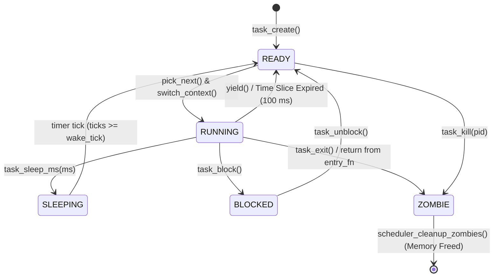

# Milestone 7: Processes & Scheduler — Parked Architectural Plan

> **Note**: Originally planned as Milestone 4, this milestone is parked for Milestone 7 after the GUI window system and apps (M4-M6) are completed. Saved per user instructions on 2026-10-29.

---

## 1. Goal
Run several independent kernel tasks "at the same time": a task structure, a context switch routine in assembly, and a round-robin scheduler driven first by `yield()` and then by the timer interrupt (preemptive multitasking). All tasks share the single kernel address space and page directory, and run in ring 0.

---

## 2. Files to Add & Modify

```text
myos/
├── include/
│   ├── arch/
│   │   └── lock.h              [NEW] Interrupt save/restore helpers (irq_save, irq_restore)
│   ├── proc/
│   │   ├── task.h              [NEW] Task struct (task_t), states, and task management API
│   │   └── scheduler.h         [NEW] Pluggable scheduler ops (scheduler_ops_t), round-robin API
│   └── drivers/
│       └── keyboard.h          [MOD] Add F9 (0x43), F10 (0x44), F11 (0x57), F12 (0x58)
├── src/
│   ├── proc/
│   │   ├── task.c              [NEW] Task creation, stack allocation (8 KB), idle & boot task
│   │   ├── scheduler.c         [NEW] Round-robin queue, sleeping queue, zombie cleanup, yield()
│   │   └── switch.asm          [NEW] switch_context routine & task_entry_trampoline
│   ├── arch/
│   │   └── irq.c               [MOD] Ensure EOI is sent before preemptive schedule()
│   ├── drivers/
│   │   ├── timer.c             [MOD] Preemption check in IRQ0 (time slice = 10 ticks = 100 ms)
│   │   ├── keyboard.c          [MOD] Handle F9-F12 scancodes for demo & stress hooks
│   │   ├── vga.c / serial.c    [MOD] Protect output routines with irq_save/irq_restore
│   │   └── kprintf.c           [MOD] Protect formatted printing with irq_save/irq_restore
│   ├── mm/
│   │   ├── heap.c              [MOD] Protect kmalloc/kfree critical sections with irq_save/restore
│   │   └── pmm.c               [MOD] Protect bitmap frame allocation with irq_save/restore
│   └── kernel/
│       └── kernel.c            [MOD] Init tasking/scheduler, convert echo loop to task, F9-F12 hooks
└── Makefile                    [MOD] Automatically builds src/proc/*.c and src/proc/switch.asm
```

---

## 3. Stack Layout Diagrams

Each task gets its own **8 KB kernel stack** allocated via `kmalloc()`. The stack top is 16-byte aligned.

### A. Initial Forged Stack (Immediately after `task_create()`, before first execution)

When `switch_context` switches to a brand new task for the very first time, it executes `pop ebp`, `pop edi`, `pop esi`, `pop ebx`, `popf`, `ret`. The stack is forged so that `ret` jumps directly into `task_entry_trampoline`:

```text
High Address (Stack Base + 8192 bytes, 16-byte aligned)
+------------------------------------+
| [Empty / 16-byte ABI padding]      |
+------------------------------------+
| Task Entry Function Pointer        | <--- Trampoline reads and calls this (e.g. entry_fn)
+------------------------------------+
| task_entry_trampoline Address      | <--- Popped by 'ret' instruction in switch_context
+------------------------------------+
| Initial EFLAGS: 0x00000202         | <--- Popped by 'popf' (IF=1 bit 9 enables interrupts)
+------------------------------------+
| Initial EBX:    0x00000000         | <--- Popped by 'pop ebx'
+------------------------------------+
| Initial ESI:    0x00000000         | <--- Popped by 'pop esi'
+------------------------------------+
| Initial EDI:    0x00000000         | <--- Popped by 'pop edi'
+------------------------------------+
| Initial EBP:    0x00000000         | <--- Popped by 'pop ebp' (Base of new call frame)
+------------------------------------+ <--- Initial task->esp points here
Low Address
```

```nasm
task_entry_trampoline:
    sti                             ; Ensure hardware interrupts are enabled for this task
    pop eax                         ; Retrieve task's entry_fn from stack
    call eax                        ; Execute task entry function
    call task_exit                  ; If entry function returns, cleanly terminate task
```

---

### B. Suspended Task Stack (Immediately after a Context Switch)

When an existing task is switched away via `switch_context(&old_task->esp, new_task->esp)`:

```text
High Address
+------------------------------------+
| ... (Active local variables & calls|
|      e.g. yield() or timer ISR)    |
+------------------------------------+
| Return Address to caller of sched()|
+------------------------------------+
| Return Address into schedule()     | <--- Caller return address (pushed by 'call switch_context')
+------------------------------------+
| Saved EFLAGS (pushf)               |
+------------------------------------+
| Saved EBX                          |
+------------------------------------+
| Saved ESI                          |
+------------------------------------+
| Saved EDI                          |
+------------------------------------+
| Saved EBP                          | <--- task->esp points here when task is not running
+------------------------------------+
Low Address
```

---

## 4. Task State Transition Diagram



---

## 5. Pluggable Scheduler Interface (`scheduler_ops_t`)

```c
typedef struct scheduler_ops {
    const char* name;                           /* "Round-Robin" */
    void (*init)(void);                         /* Initialize policy structures */
    void (*add_task)(task_t* task);             /* Enqueue task into runnable pool */
    void (*remove_task)(task_t* task);          /* Remove task from runnable pool */
    task_t* (*pick_next)(void);                 /* Select next task according to policy */
    void (*task_tick)(task_t* current);         /* Update per-task tick accounting */
} scheduler_ops_t;
```

---

## 6. Critical Sections & Synchronization Strategy

Nested interrupt masking via `irq_save()` and `irq_restore(flags)`.
Protected sections:
1. Scheduler queues (`ready_queue`, `sleep_queue`, `zombie_queue`).
2. `schedule()` and `switch_context()`.
3. Memory allocators (`kmalloc`, `kfree`, `pmm_alloc_frame`, `pmm_free_frame`).
4. Dual-sink console and driver outputs (`kprintf`, VGA, Serial).
5. Zombie cleanup.

---

## 7. Foreseen Risks & Concrete Mitigations

1. **Delayed PIC EOI**: Unconditionally send `pic_send_eoi(0)` *before* calling `schedule()` in IRQ0 path.
2. **Freeing Active Stack**: `task_exit()` only marks `TASK_ZOMBIE`. The idle task or post-switch scheduler hook frees deceased stacks on a separate stack.
3. **Boot Task Stack Free**: Set `task->is_boot_task = true` for PID 1 (kernel main); skip `kfree()` for boot stack.
4. **Initial EFLAGS IF Bit**: Set `TASK_INITIAL_EFLAGS 0x00000202` (IF=1 bit 9).
5. **Re-entrancy in Allocator**: Wrap `kmalloc`, `kfree`, PMM in `irq_save()` / `irq_restore()`.
6. **Idle Task in Run Queue**: PID 0 is never enqueued into `ready_queue`; selected only when `ready_queue` is empty.
7. **Stack Misalignment**: Align stack top to 16 bytes.
8. **Lost Sleep Wakeups**: `task_sleep_ms` runs atomically under `irq_save()`.
